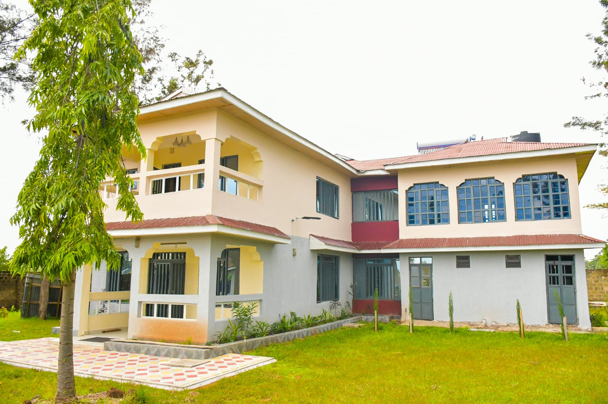

# Lattafa Luxury Retreat & Airbnb

**Elegant stays. Trusted hosting.**

A modern accommodation website for a family-run retreat behind Kibos Rice Mills in **Kisumu, Kenya**. Discover private suites, spacious family villas and the whole compound through real property photography, room details and a direct booking enquiry experience.

[Visit the website](https://lattafaluxuryretreat.netlify.app/) · [Explore rooms](https://lattafaluxuryretreat.netlify.app/rooms.html) · [View the gallery](https://lattafaluxuryretreat.netlify.app/gallery.html) · [Enquire about a stay](https://lattafaluxuryretreat.netlify.app/book.html)

## The website

- **A welcoming homepage** with an introduction to the retreat and its accommodation collection.
- **Rooms and rates** with dedicated sections for suites, family villas and private compound bookings.
- **An interactive photo gallery** with category filters, a thumbnail carousel, a natural-proportion photo grid and a full-size viewer with keyboard and touch navigation.
- **Amenities and location pages** with arrival guidance and a Google Maps link to the nearby landmark.
- **Direct contact links** for phone calls, WhatsApp and email.
- **Responsive layouts** with mobile navigation and clearly labelled booking fields.

## Guest reviews

The homepage links to `reviews.html`, where guests can submit a rating and written feedback through the `guest-review` Netlify Form. Submitted reviews are private and pending review; they are never published automatically. The form asks for permission to publish the guest's first name, rating, month of stay and review. Email addresses remain private in Netlify Forms.

To feature feedback, first confirm the stay and publication permission, then add only the approved public fields to `assets/reviews.json` and deploy. Each entry uses `name` and `text`, with optional `title`, `accommodation`, `rating` (guest-selected integer 1–5), `stayMonth` (`YYYY-MM`), `sourceLabel`, and `sourceUrl` (HTTPS). Do not add emails, phone numbers or booking details to that public file. Five owner-supplied testimonials are included without invented scores or dates. An average is shown only when guest ratings are supplied, using only those rated entries. When no entries exist, the site shows an invitation to share a stay. Existing Netlify email notifications configured for all forms also cover new review submissions; delivery depends on the site's Netlify notification settings.

## Accommodation

| Stay | Advertised nightly rate |
| --- | ---: |
| 1 Bedroom Suite | KSh 3,000 |
| 2 Bedroom Suite | KSh 4,000 |
| 3 Bedroom Family Villa | KSh 6,000 |
| 4 Bedroom Family Villa | KSh 7,500 |
| Whole Compound / Private Event — 8 bedrooms | KSh 15,000 |

Availability and final arrangements are confirmed directly by the hosting team.

## Booking and payments

Guests select dates, accommodation and guest details, then see an estimated stay total. Enquiries are collected through **Netlify Forms**, with owner email notifications configured in the Netlify dashboard.

The booking interface includes full payment, a deposit and pay-at-check-in choices. Standard stays use a 30% deposit; whole-compound and private-event bookings use a 50% deposit. The percentage and exact amount are calculated again on the server before checkout so visitors cannot alter the price in their browser.

Online payments use **Paystack hosted checkout** for M-Pesa and cards. Netlify Functions initialize the transaction, store the expected booking amount in signed Paystack metadata, verify the returned reference, currency and exact amount, and validate signed Paystack webhooks. Successful webhooks create a private `payment-confirmation` Netlify Form submission so the owner can receive the existing form notification and reconcile it with the Paystack dashboard.

Set `PAYSTACK_SECRET_KEY` privately in Netlify. A test key enables online payment choices only on `book.html?payment-test=1`; normal visitors continue to see pay-at-check-in while testing is underway. A live key enables online payment choices on the normal booking page. Never expose or commit the secret key.

Bookings are confirmed by the Lattafa team after availability is checked. The website does not promise an automatic date hold, and online payment alone is not presented as final availability confirmation.

## Technology

The site uses **HTML, CSS and vanilla JavaScript**, with **Netlify** hosting, form handling and serverless functions. There is no frontend framework or build step.

| File or folder | Purpose |
| --- | --- |
| `index.html` | Main homepage |
| `rooms.html`, `gallery.html`, `amenities.html`, `location.html` | Property pages |
| `book.html`, `booking-policy.html` | Booking enquiry and guest policy |
| `thank-you.html`, `payment-success.html` | Enquiry and payment return pages |
| `assets/gallery/` | Property photography |
| `styles/site.css` | Shared styling and responsive layouts |
| `scripts/` | Navigation, gallery and booking interactions |
| `netlify/functions/` | Paystack checkout, strict verification, signed webhook and configuration-status endpoints |
| `netlify.toml` | Hosting, function directory and legacy URL redirects |

## Preview and deployment

Open `index.html` in a browser to preview the pages and design. Netlify Forms and serverless payment endpoints require a Netlify environment; opening local HTML files does not run those services.

The connected Netlify project deploys from this repository's `main` branch. The publish directory is the repository root, and functions are located in `netlify/functions/`. Legacy page addresses redirect to their current equivalents.

Store Paystack credentials privately in Netlify environment variables. **Never commit API keys, credentials or guest booking data to GitHub.**

In the Paystack dashboard, set the webhook URL to `https://lattafaluxuryretreat.netlify.app/.netlify/functions/paystack-webhook`. Test transactions must be completed and verified before replacing the test secret with the live secret.

## Contact

**Phillip Adundo — Lattafa Luxury Retreat & Airbnb**

- Phone: [+254 712 816 019](tel:+254712816019)
- WhatsApp: [Message Phillip](https://wa.me/254712816019)
- Email: [lattafabnbresort@gmail.com](mailto:lattafabnbresort@gmail.com)
- Location: Behind Kibos Rice Mills, Kisumu, Kenya

Built and maintained by [Menelik Adundo](https://github.com/MenelikAdundo).
