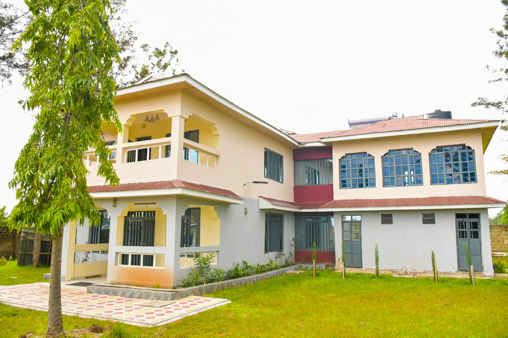

# Lattafa Luxury Retreat & Airbnb

**Elegant stays. Trusted hosting.**

A modern accommodation website for a family-run retreat behind Kibos Rice Mills in **Kisumu, Kenya**. Discover private suites, spacious family villas and the whole compound through real property photography, room details and a direct booking enquiry experience.

[Visit the website](https://lattafaluxuryretreat.netlify.app/) · [Explore rooms](https://lattafaluxuryretreat.netlify.app/rooms.html) · [View the gallery](https://lattafaluxuryretreat.netlify.app/gallery.html) · [Enquire about a stay](https://lattafaluxuryretreat.netlify.app/book.html)

## The website

- **A welcoming homepage** with an introduction to the retreat and its accommodation collection.
- **Rooms and rates** with dedicated sections for suites, family villas and private compound bookings.
- **A categorized photo gallery** covering bedrooms, living spaces, kitchens, bathrooms and grounds, with full-image previews.
- **Amenities and location pages** with arrival guidance and a Google Maps link to the nearby landmark.
- **Direct contact links** for phone calls, WhatsApp and email.
- **Responsive layouts** with mobile navigation and clearly labelled booking fields.

## Accommodation

| Stay | Advertised nightly rate |
| --- | ---: |
| 1 Bedroom Suite | KSh 3,000 |
| 2 Bedroom Suite | KSh 4,000 |
| 3 Bedroom Family Villa | KSh 6,000 |
| 4 Bedroom Family Villa | KSh 7,500 |
| Whole Compound / Private Event — 8 bedrooms | KSh 15,000 |

Availability and final arrangements are confirmed directly by the hosting team.

## Booking and payments

Guests select dates, accommodation and guest details, then see an estimated stay total. Enquiries are collected through **Netlify Forms**, with owner email notifications configured in the Netlify dashboard.

The booking interface includes full payment, a 30% deposit and pay-at-check-in choices. A separate [booking policy](booking-policy.html) explains payments, cancellations and date changes; whole-compound and private-event arrangements require a 50% deposit under that policy.

**Current payment status:** Flutterwave checkout and verification functions are scaffolded. The interface disables online payment choices when `FLW_SECRET_KEY` is absent. Live payment acceptance still needs merchant setup, complete booking/payment reconciliation, policy-aligned deposit handling and end-to-end testing. The current online deposit calculation is 30%; the 50% group/event rule is not yet enforced by checkout. Adding a key alone does not complete production payment readiness.

Bookings are confirmed by the Lattafa team. Automatic room inventory, date holds and guest confirmation emails are not implemented.

## Technology

The site uses **HTML, CSS and vanilla JavaScript**, with **Netlify** hosting, form handling and serverless functions. There is no frontend framework or build step.

| File or folder | Purpose |
| --- | --- |
| `index.html` | Main homepage |
| `rooms.html`, `gallery.html`, `amenities.html`, `location.html` | Property pages |
| `book.html`, `booking-policy.html` | Booking enquiry and guest policy |
| `thank-you.html`, `payment-success.html` | Enquiry and payment return pages |
| `assets/gallery/` | Property photography |
| `styles/site.css` | Shared styling and responsive layouts |
| `scripts/` | Navigation, gallery and booking interactions |
| `netlify/functions/` | Flutterwave checkout, verification and configuration-status endpoints |
| `netlify.toml` | Hosting, function directory and legacy URL redirects |

## Preview and deployment

Open `index.html` in a browser to preview the pages and design. Netlify Forms and serverless payment endpoints require a Netlify environment; opening local HTML files does not run those services.

The connected Netlify project deploys from this repository's `main` branch. The publish directory is the repository root, and functions are located in `netlify/functions/`. Legacy page addresses redirect to their current equivalents.

Store Flutterwave credentials privately in Netlify environment variables. **Never commit API keys, credentials or guest booking data to GitHub.**

## Contact

**Phillip Adundo — Lattafa Luxury Retreat & Airbnb**

- Phone: [+254 712 816 019](tel:+254712816019)
- WhatsApp: [Message Phillip](https://wa.me/254712816019)
- Email: [lattafabnbresort@gmail.com](mailto:lattafabnbresort@gmail.com)
- Location: Behind Kibos Rice Mills, Kisumu, Kenya

Built and maintained by [Menelik Adundo](https://github.com/MenelikAdundo).
